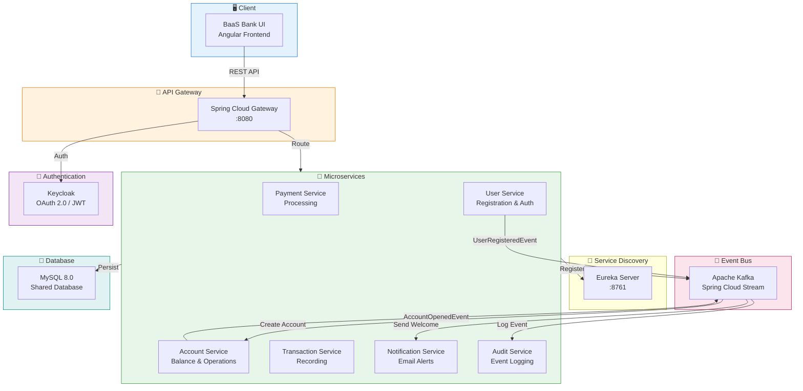

> Modernized to Spring Boot 4.1.1 / Spring Cloud 2025.1.3. See [MODERNIZATION.md](MODERNIZATION.md) for current startup, UI integration, dependency changes and limitations.

# Banking as a Service (BaaS) Platform

## Overview

A demonstration Banking as a Service platform built with Spring Boot microservices architecture, featuring modern saga choreography patterns for distributed transaction management. The platform provides a robust foundation for core banking operations, with a focus on event-driven design, security, and extensibility.

---

## Key Features

- **Saga Choreography Pattern**: Distributed transactions, with services coordinating through Kafka events and compensation logic.
- **Comprehensive Banking Operations**: User onboarding, account management, payment processing, and transaction recording.
- **Event-Driven Communication**: Apache Kafka with Spring Cloud Stream for reliable asynchronous messaging.
- **Security & Authentication**: OAuth 2.0/JWT integration with Keycloak, role-based access control (RBAC).
- **Production-Ready Infrastructure**: MySQL database, Docker containerization, service discovery, and API gateway.
- **Audit Trail**: Complete audit logging for all critical events and operations.

---

## Architecture



### Technology Stack

- **Framework**: Spring Boot with Java 21
- **Build Tool**: Maven multi-module project with centralized dependency management
- **Database**: MySQL 8.0 shared among services with logical separation via schemas/table prefixes
- **Authentication**: Keycloak (OAuth 2.0, OpenID Connect, JWT)
- **Messaging**: Apache Kafka + Spring Cloud Stream for event-driven architecture
- **Service Discovery**: Eureka-based registration and health monitoring
- **Gateway**: Spring Cloud Gateway (API Gateway)
- **Orchestration Pattern**: Saga Choreography for distributed transaction management
- **Infrastructure**: Docker Compose for local development and rapid prototyping

### Microservices

1. **API Gateway** - Unified entry point with routing and authentication
2. **Service Discovery** - Eureka-based service registry and health checks
3. **User Service** - User registration, authentication, and management
4. **Account Service** - Account lifecycle management, balance ops, payment processing
5. **Transaction Service** - Transaction recording and history
6. **Payment Service** - Payment validation, processing, and status management
7. **Notification Service** - Event-driven email notifications for banking operations
8. **Audit Service** - Centralized audit logging and trail
9. **Common Library** - Shared DTOs, events, and utilities

---

## Saga Flows

### 1. User Onboarding Saga

**Flow Steps:**
1. **Register User**: User Service creates the user via `POST /users`
2. **Publish UserRegisteredEvent**: User Service emits event to Kafka
3. **Open Account**: Account Service listens, creates account (skips BAAS_ADMIN), emits AccountOpenedEvent or AccountOpenFailedEvent
4. **Notify User**: Notification Service listens for AccountOpenedEvent and sends welcome notification
5. **Audit Logging**: Audit Service logs each event

**Error Handling**: AccountOpenFailedEvent triggers user deletion (compensation logic).

**Event Flow:**

| Step            | Publisher      | Event Name                                  | Subscriber(s)                       |
|-----------------|---------------|---------------------------------------------|-------------------------------------|
| Register User   | user-service  | UserRegisteredEvent                         | account-service                     |
| Open Account    | account-service| AccountOpenedEvent / AccountOpenFailedEvent | notification-service, audit-service |
| Notify User     | notification-service | (notification sent)                   | -                                   |
| Audit Logging   | all services   | All above events                            | audit-service                       |

### 2. Payment Processing Saga

**Flow Steps:**
1. **Initiate Payment**: Payment Service receives payment request via `POST /payments`
2. **Publish PaymentInitiatedEvent**: Payment Service emits event
3. **Validate Account**: Account Service checks source account, emits PaymentValidatedEvent/PaymentFailedEvent
4. **Update Account Balance**: Account Service updates balances, emits AccountBalanceUpdatedEvent
5. **Process Payment**: Payment Service marks payment as processed, emits PaymentProcessedEvent
6. **Record Transaction**: Transaction Service records DEBIT/CREDIT transactions, emits TransactionRecordedEvent
7. **Notify User**: Notification Service sends payment notification
8. **Audit Logging**: Audit Service logs all events

**Error Handling**: PaymentFailedEvent triggers compensation and user notification.

**Event Flow:**

| Step                   | Publisher           | Event Name                                 | Subscriber(s)                         |
|------------------------|---------------------|--------------------------------------------|---------------------------------------|
| Initiate Payment       | payment-service     | PaymentInitiatedEvent                      | account-service                       |
| Validate Account       | account-service     | PaymentValidatedEvent / PaymentFailedEvent | payment-service                       |
| Update Account Balance | account-service     | AccountBalanceUpdatedEvent                 | payment-service, notification-service |
| Process Payment        | payment-service     | PaymentProcessedEvent                      | transaction-service, audit-service    |
| Record Transaction     | transaction-service | TransactionRecordedEvent                   | audit-service                         |
| Notify User            | notification-service| (notification sent)                        | -                                     |
| Audit Logging          | all services        | All above events                           | audit-service                         |

### 3. Account Closure Saga (Planned)
- Account closure request triggers validation, handles pending transactions, closes account, notifies user, and logs audit.
- Compensation events prevent closure if there are pending transactions.

### 4. Transaction Dispute Saga (Planned)
- Dispute request → account freeze → investigation → resolution/notification → audit.
- Compensation logic for rejected disputes.

---

## API Endpoints (Sample)

- `POST /users` – Register new users
- `POST /payments` – Initiate payment
- `POST /accounts/{id}/close` – Request account closure (planned)
- `POST /transactions/{id}/dispute` – Raise transaction dispute (planned)
- `GET /audit/logs` – Retrieve audit trail (admin only)

---

## Authentication & Authorization

- **Keycloak Integration**: OAuth 2.0, OpenID Connect, JWT tokens
- **Roles**: 
  - **BAAS_ADMIN**: Full system access, can view all data and perform admin tasks
  - **ACCOUNT_HOLDER**: Standard user operations, access to own data only
- **Security Policies**:
  - API Gateway enforces bearer tokens and authentication
  - Service-level method security and endpoint restrictions
  - Password policy: Minimum 8 characters with complexity enforcement

---

## Quick Start

### Prerequisites
- Java 21
- Docker & Docker Compose
- Maven 3.8+

### Running the Platform

1. **Start All Services with Docker Compose**
    ```bash
    ./start-docker-compose.sh
    ```
    Launches all infrastructure and microservices for local development.

2. **Access Points**
    - API Gateway: http://localhost:8080
    - Keycloak Admin: http://localhost:8180/admin (admin/admin)
    - Service Discovery: http://localhost:8761

---

## Observability & Tracing

- Audit logging for all critical events and saga steps
- Planned support for service health checks, metrics, distributed tracing, and centralized logging

---

## Implementation Status

- ✅ User onboarding and payment processing sagas fully implemented with compensation and audit
- 🟡 Account closure and dispute sagas planned
- 🟡 Advanced monitoring, error handling, and circuit breaking planned

---

## Development Guidelines

- Modern Java (21) and Spring Boot best practices
- Centralized dependency management in Maven
- All shared constants/utilities in `common-lib`
- Event-driven development with builder pattern for events

---

## Roadmap

- [x] User registration and authentication
- [x] Account creation and management
- [x] Payment processing and fund transfers
- [x] Transaction recording and history
- [x] Email notifications for key events
- [ ] Account closure workflows
- [ ] Transaction dispute handling
- [ ] Enhanced security and authorization
- [ ] Comprehensive error handling and retry mechanisms
- [ ] Circuit breaker patterns for resilience
- [ ] Comprehensive integration testing
- [ ] Monitoring and observability

---

## Testing & Quality Assurance

- Unit and integration tests for business logic and saga flows (expanding)
- Planned contract and end-to-end testing
- Code coverage, static analysis, and security scanning (planned)

---

## Monitoring & Business Metrics (Planned)

- Service health checks and distributed tracing
- Transaction success rates, payment processing times, onboarding rates, system uptime

---

## License

MIT

---
